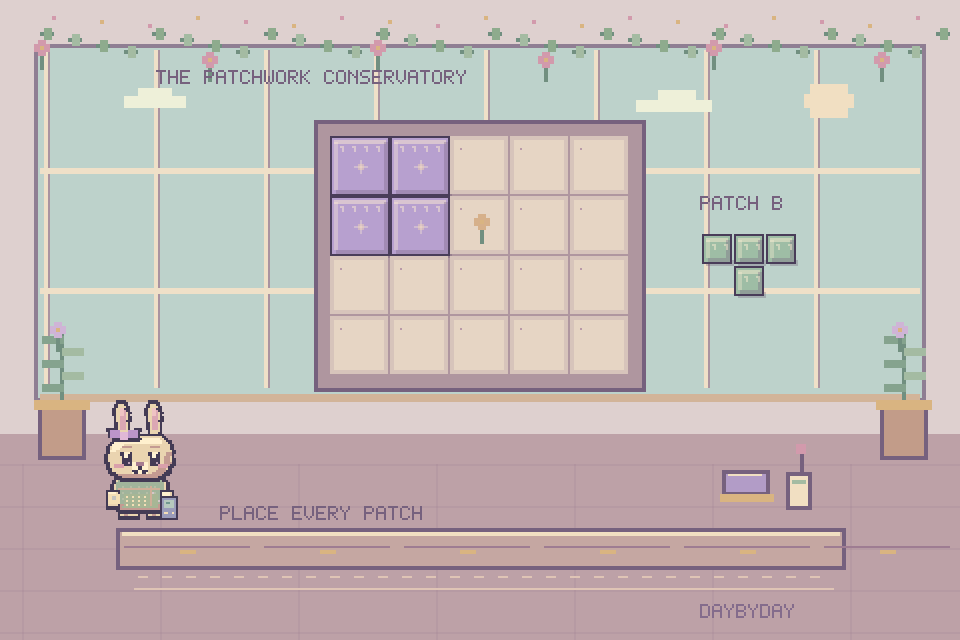
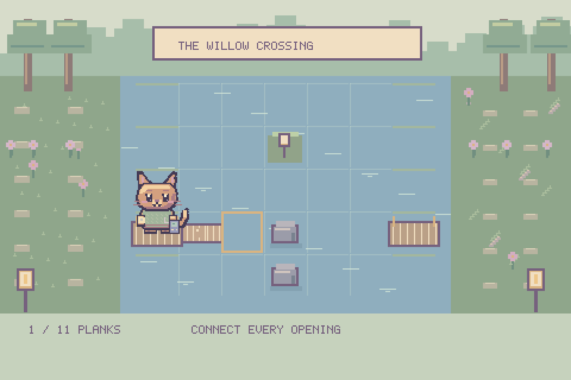
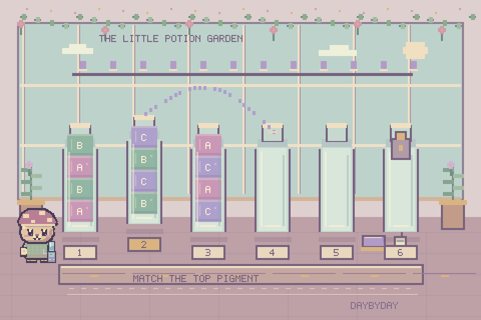

# Cozy arcade redesign

## Implementation order

After inspecting the original monolithic games, Block Puzzle was built, tested and rendered first, followed by Bridge Adventure, then Color Garden. Each has four authored chapters rather than an unverified generator.

## Block Puzzle — The Patchwork Conservatory

The original single 4×4 tiling board becomes a patchwork puzzle with larger and irregular frames, new polyomino silhouettes, a patch-specific flower seal, a blocked stone corner, and a later mirrored patch. Hover previews show valid placement; tapping placed patches lifts them. A hint highlights the selected patch's authored reference position and lowers the final score. Every patch must fit exactly. Moves, hints, best scores and stars provide replay goals without time pressure.

The DOM playthrough caught and corrected an L-shaped-piece anchor bug: a valid placement now takes priority over lifting a piece underneath the empty corner of its bounding box.

## Bridge Adventure — The Willow Crossing

The old length arithmetic becomes directional route planning. Straight and corner tiles have explicit openings that must connect. Banks and rocks cannot be built on. A plank budget and required lantern stops constrain each route. The crossing animation follows the model's validated path and freezes on pause. A failed crossing test keeps the build intact. Later chapters add turns, checkpoints and terrain. Scores reward efficient construction. This is a route puzzle, not a physics simulation.

## Color Garden — The Little Potion Garden

Four solver-verified chapters introduce two pigments, three pigments in taller bottles, an extra bottle sealed until a color is completed, then four pigments. Legal pours transfer the maximal matching top group up to destination capacity. Lifted bottles, a pixel stream, source/destination changes, and completed-bottle blossoms provide feedback. Letters identify pigments independently of hue. Input locks during transfer; pause freezes animation; undo restores the previous complete state. A no-legal-moves message recommends undo or restart. Scores reward fewer pours.

## Shared screens, controls and persistence

Every game includes title, instructions, gameplay, pause/resume, completion, restart and chapter selection with unlocks. Pointer events support mouse and touch; coordinates map from the displayed Canvas size. On the focused Canvas: arrows move a cell/bottle cursor, Enter selects/places, R rotates, M mirrors where available, U undoes, and Escape pauses. Native buttons are keyboard reachable and at least 44 CSS pixels high. Hiding the page or opening the parent portal pauses gameplay. Reduced motion suppresses decorative motion and shortens crossings/pours.

Completed chapters, best scores, stars and daily coin claims persist in the existing local state. Unfinished puzzle layouts do not survive reloads. Legacy completions are retained in saved data but are not converted into new chapter stars. Coins are local demo currency, not server-authoritative payment entitlements. Rewards never consume glucose or device data.

## Artwork and checks

Original integer-grid environments, cloth patches, timber planks, rocks, lanterns, glass vials, pigment patterns, foliage, water ripples, flowers and a bitmap alphabet are rendered by `art.js`. No emoji or CSS shapes serve as final game artwork. Companions use the existing layered sprite renderer and equipped cosmetics. The PNGs above come from the actual Canvas renderer.

Tests cover every chapter's solvability; illegal moves; constraints; undo; scores/reward deduplication; title/help/pause/restart/completion; full DOM pointer playthroughs; mobile-scaled touch coordinates; keyboard controls; animated input locks; crossing/pour pause; 48 level/companion renders; and visible animation-frame variation. Existing education, routine, family-reward, OAuth and Worker-build tests also run.

Verification limit: full browser layout, real touch devices and screen-reader usability have not been verified here. DOM checks use LinkeDOM and native Canvas; they are not browser/device tests. The PNGs show gameplay Canvas renders, not browser screenshots. Run device/browser QA before merging and publishing.

## Scope

Character artwork, pet rendering, customization/shop, Dexcom, server secrets, medical events, journals and family-portal source are unchanged. `games()` delegates to the new shell; old monolithic game functions were removed. The live Site is not deployed by this branch.
