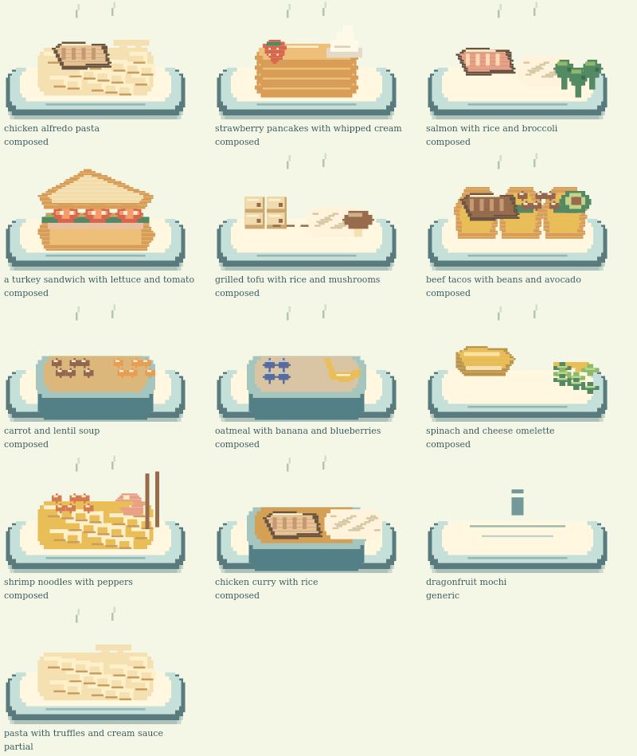

# DiaBuddy meadow identity and meal studio

The branch is based on main commit `1c55562`, which includes the redesigned arcade. The existing HTML/CSS/JS/Canvas architecture remains in place.

## Inspection and implementation

The previous meal model downloaded an embedding model and selected the nearest food category. The pixel renderer then collapsed several categories into the same burger, pancake or mixed-bowl drawing. The updated meal studio parses a finite English component library instead. It preserves the input name and composes dish silhouettes, proteins, sides, toppings and preparation details. It is not an arbitrary generative AI image service. No image-generation service is configured in the backend.

The original normal activity catalog exposed Hungry and Sweating. Low glucose forced Snacking, which drew sweat drops; the older fallback renderer also shivered and drew sweat. These triggers are removed. Glucose values still display and use personal range labels, while pets keep a neutral, nonjudgmental activity across glucose states. Feeding, water breaks, walking, blinking, sleep, celebration and customization remain.

## Identity and navigation

Displayed identity is DiaBuddy; the slogan is exactly `a little T1D friend, everyday`. The logo and six navigation icons are original crisp SVG artwork. The child/shared sidebar has unique house, clothing, controller, timer, journal and gear silhouettes, accessible names and selected states. The parent view remains its PIN-protected dashboard, with the same branding and shared palette; it does not have separate navigation tabs to replace. Journal and preferences now have explicit sidebar entry points. Existing journal entries are retained; new pages store mood, energy, a little win and thoughts. Preferences expose existing personal range settings and the Dexcom panel.

`theme.css` applies the sage, teal, sky, cream, yellow and peach UI palette. The default room and arcade Canvas artwork use coordinated colors. Optional clothing, character silhouettes and themed worlds retain their individual identity. All original sprite sheets and equipment definitions remain intact. Browser metadata and the visible Dexcom sign-in message use DiaBuddy. Legacy storage keys, OAuth URLs, cookie names and protocol headers intentionally retain their original values for compatibility.

## Meals and honest limits

Supported components include chicken, turkey, salmon/fish, tofu, beef, beans/lentils, shrimp, rice, broccoli, lettuce, tomato, spinach, mushrooms, avocado, carrots, peppers, potatoes, corn, cucumber, eggs, cheese, berries, banana, whipped cream and sauces. Dish drawings include pasta, pancakes, sandwiches, pizza, noodles, curry, soup, salad, tacos, dumplings, burgers, toast, oats, ice cream, rice and protein plates. Grilled/roasted markings, scrambled eggs and folded omelettes have distinct drawing details. Illustrations are stylized approximations, not photographs or ingredient verification.

Unknown words remain visible in a partial-coverage note. Unknown dishes such as “dragonfruit mochi” display a generic plate; they are not silently reclassified. The parser is English and finite, not a complete natural-language understanding system. It supports simple exclusions, not arbitrary complex dietary instructions. Generic berry terms and regional recipes may be unsupported. Existing saved meal names remain intact; old illustration IDs are not silently reinterpreted as a precise new recipe. Optional manual category illustrations are clearly labeled as manual choices.

Loading, success/coverage, error and retry states are explicit. Editing input invalidates pending results. The exact saved recipe feeds the pet-table renderer. Meal text never leaves the device, and no carbohydrate amounts, nutritional calculations or insulin advice are derived.

## Checks and remaining verification

`npm test` runs existing OAuth, Worker, education, family, routine and all arcade checks plus `branding-meals.test.cjs`. New checks initialize the full app script order against DOM/native Canvas, verify unique navigation icons and exact branding, preserve seeded coins/outfit/arcade progress/old journal entries, save meal recipes and journal/preferences, exercise manual illustration choice, and unlock/relock the parent portal with a PIN. Eight characters render in five activities; identical low/range/high Canvas outputs confirm glucose alone does not change the pet's visual state. Shared text/action color pairs meet 4.5:1 contrast in the checked palette combinations.

Thirteen meal descriptions were rendered and checked, including all four requested examples, tofu/rice/mushrooms, beef tacos, lentil soup, banana/blueberry oats, spinach/cheese omelette, shrimp noodles, chicken curry, an unknown dish and a partial truffle-pasta illustration. Pixel comparisons verify changes to sauce, toppings and sides change artwork rather than only a label. The images above are actual Canvas renders, not browser screenshots.

Full desktop/mobile CSS layout, real touch devices and screen-reader checks remain manual: browser control is unavailable in this environment. Before merging, review at 320/390/768/1440 px, use keyboard navigation, open PIN/modals, and share a meal while the pet walks to its table. Existing simulated location/app reminders remain simulated; this update adds no device monitoring. This branch does not publish or change the original Site, its audience, runtime secrets or the separate review Site.
