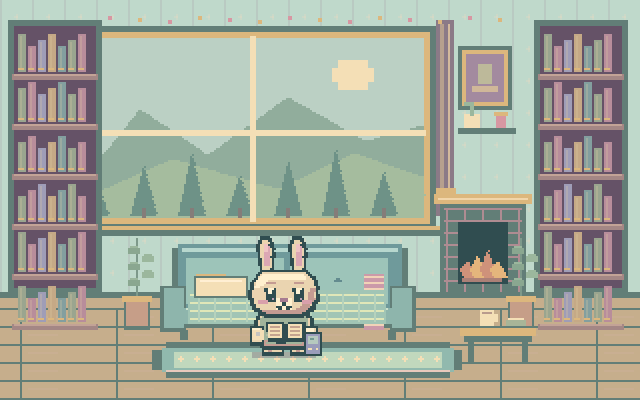
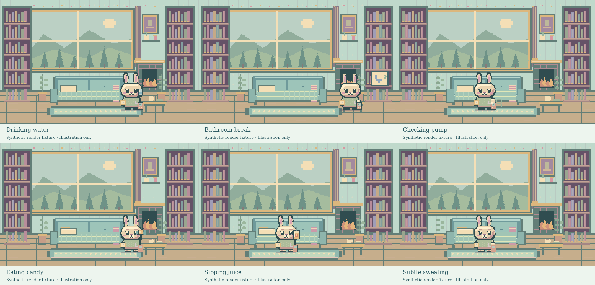
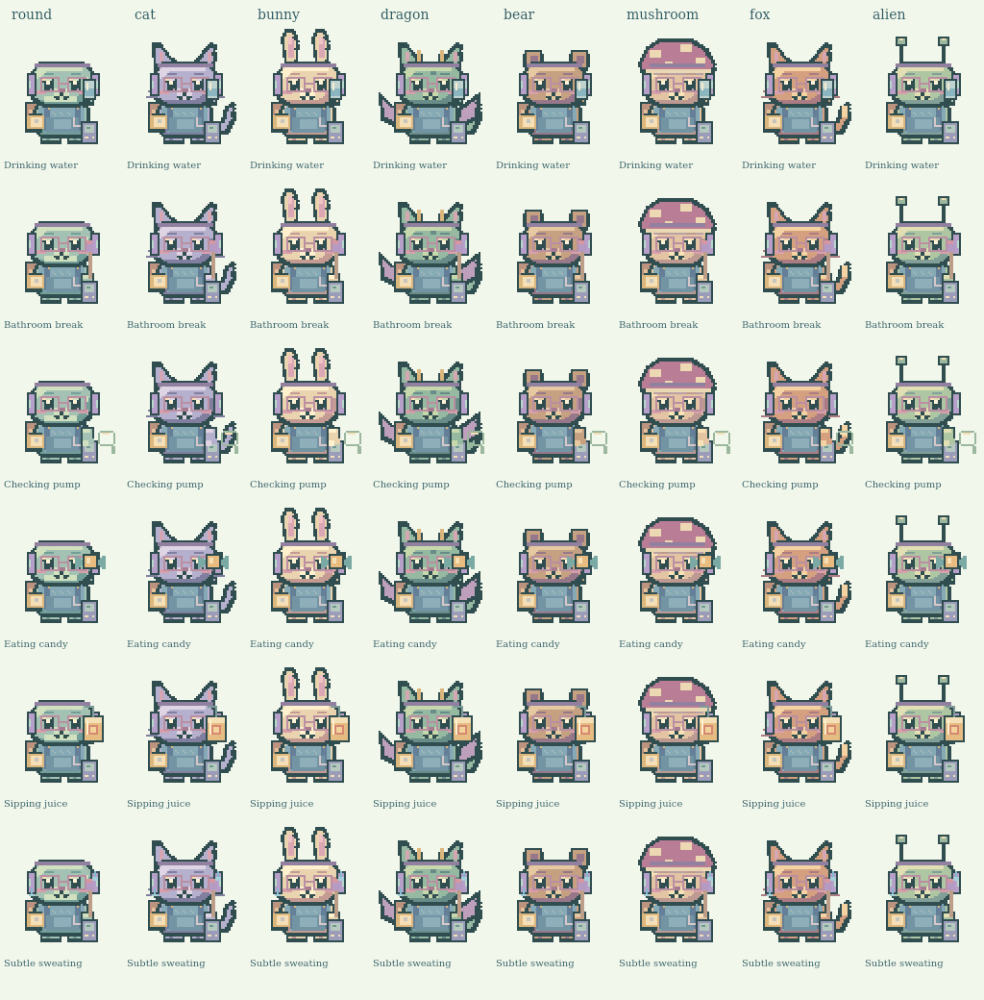

# Teal home hub and contextual companion illustrations

Created from upgraded main `68f301c` on `feat/teal-home-and-contextual-emotes`. The HTML/CSS/JavaScript/Canvas architecture is retained. This branch does not publish a Site or change credentials, permissions or OAuth configuration.

## Inspection and design

The previous palette change in `557b2ce` replaced the earlier teal/sage palette with yellow/olive. The earlier colors from `c2f58e2` are restored for the shared theme, logo, default room and arcade artwork. For Canvas files, the historical comparison was checked to contain only color differences before restoring colors; newer application features were not reverted. Branding remains DiaBuddy and the exact slogan remains `a little T1D friend, everyday`.

The old customization teaser occupied a separate two-column `.lower` row after the entire dashboard, so it waited for the taller meal column. It now sits directly beneath the character card in an independent `.home-world-column`. The miniature uses the actual current companion and outfit renderer. The side column and smaller-screen layout use natural content height rather than fixed spacer heights. Customization still opens the existing wardrobe/shop.

Learning remains the immediate next sibling of `#activity-tray`. Its native details/summary supports keyboard expansion, with a book icon, completion summary, lesson-library cards, step progress, speech panel and completion state. Lesson content, back/next navigation and one-time five-coin rewards are retained. Completed stories clearly offer replay without advertising another reward. The activity catalog, existing emote button markup, selection function and activity-picker function are unchanged.

## Parent settings and visual policy

Existing `state.thresholds` values are retained. The earlier range editor was shared child preferences; editing is now exposed in the existing PIN-protected parent portal. Child preferences display the ranges and can open the parent PIN flow. Parents can also disable contextual illustrations. The existing PIN is still a browser-local beta barrier, not secure medical-account authentication; there is no new identity system.

`glucose-emotes.js` is a read-only policy module with no storage, network, logging or reward access. It accepts only connected, error-free sanitized G7 readings in mg/dL with valid numeric values/statuses and a timestamp no more than 15 minutes old. Invalid, future-dated, missing, stale and disconnected data use the ordinary routine. Explicit demo readings never substitute for missing connected data.

Boundary semantics match the existing classifier: `value <= low` is low and `value >= high` is high. Parent edits are validated and persisted using the existing save, without resetting coins, inventory, lessons or games.

High-context illustrations are water, a discreet bathroom sign/approach, and inspecting the pump screen. Low-context illustrations are wrapped candy, a juice carton/straw and subtle sweat drops. Props attach to the existing animated hands; characters retain their usual expressions and equipment. Bathroom movement uses the existing gradual walking approach. There is no dose, delivery, correction command or numerical treatment cue. **Correction animations are unavailable:** no verified, read-only pump-event adapter exists, and demo bolus fixtures cannot enable one.

The visual director yields to manual activities, feeding, sleep, open lessons, dialogs, celebrations, try-on states and hidden content. It includes a settling delay, short contextual sequence and quiet interval. These timings are for illustration only, never treatment or meal-waiting recommendations. Reduced motion freezes sprite/environment motion, snaps position changes, and uses one stable contextual pose during a sequence. Default idle/routine choices never include sweating, hungry or contextual treatment imagery.

Visible notes explain that sandbox readings are simulated and contextual illustrations are not treatment instructions. Existing timer/game/learning reward code is unchanged; the contextual module cannot award coins or change health, happiness, inventory or progression. No glucose values or medical events are added to animation logs.

The montages are generated with synthetic render fixtures; it does not show a live authenticated Dexcom session.

## Verification and limits

The full existing test suite passes with new checks for threshold boundaries, parent updates, invalid sensor/status/unit/value/timestamps, stale/future data, quiet intervals, reduced motion and activity priorities. DOM checks exercise the parent PIN/range editor and reject saves after relocking, preserve coins/outfits/game progress, verify unchanged emote controls and customization placement, and complete/replay both lessons without duplicating rewards. Snapshot comparisons ensure contextual selections do not mutate the saved app state.

Native Canvas checks render eight characters in six contexts across eight frames (384 combinations), verify distinct scenes and frame changes, reduced-motion stability and gradual bathroom movement. `scripts/render-contextual.cjs` creates the montage from the actual shared renderer. OAuth origin, callback diagnostics, encryption, refresh rotation, Workers-compatible fetch and all mini-game checks remain in the suite. Backend source and game models are unchanged from main.

Full browser layout, screen-reader use and physical mobile/touch interaction could not be inspected because browser control is unavailable in this session. The images are Canvas renders, not full-app browser screenshots. Before merging, inspect widths 320/390/768/1440 px, expand/collapse lessons, use keyboard navigation, check the compact customization placement and verify no clipping. Existing Canvas pointer/touch model tests still pass, but they do not verify the new home CSS geometry.

Dexcom sandbox data may be historical and therefore stale: it should remain neutral rather than being rewritten as fresh. Live OAuth and real G7 retrieval are not claimed verified by this branch. Existing location/app reminder behavior remains explicitly simulated; no monitoring or pump integration has been added.
